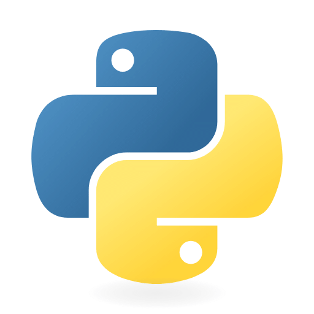
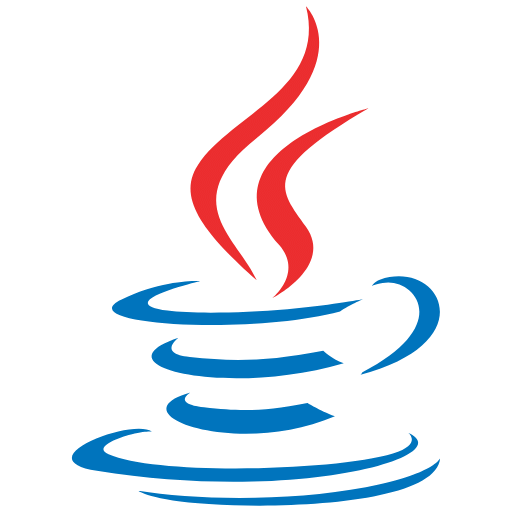
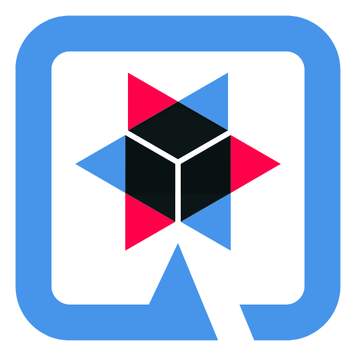
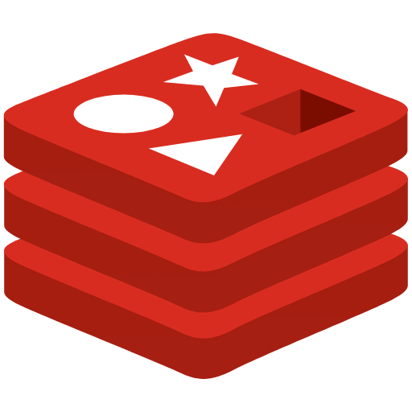
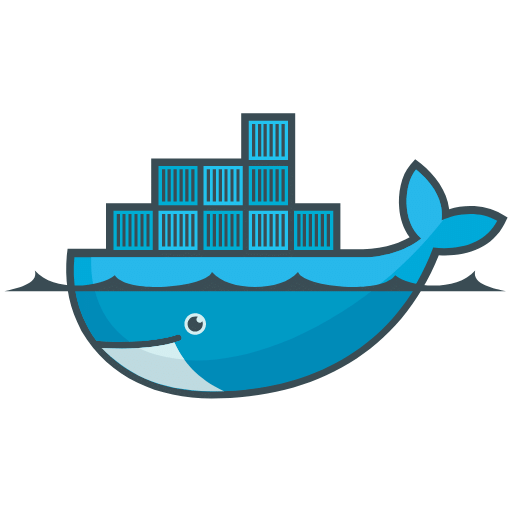
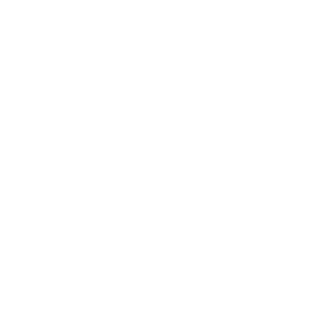
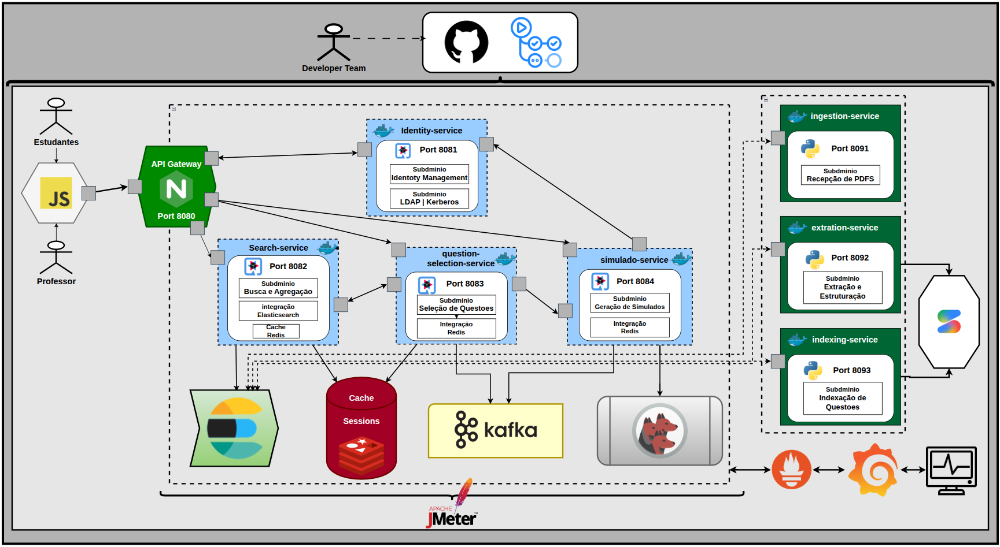
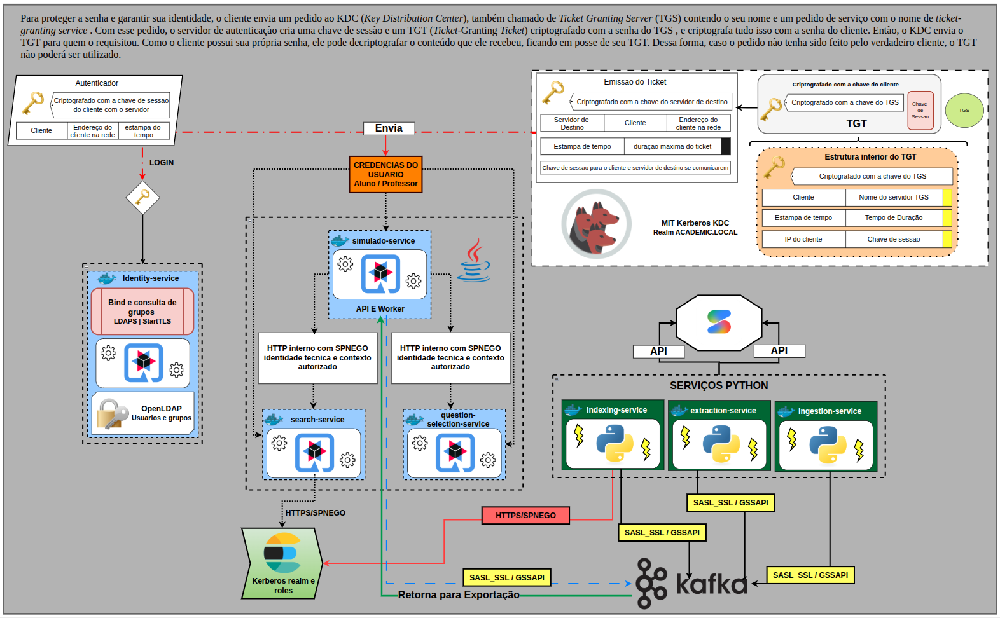
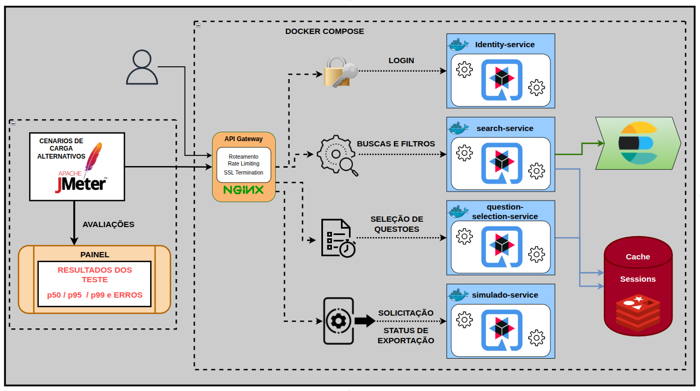

  <strong>Plataforma Distribuída de busca e indexação</strong>

  Plataforma que combina processamento distribuído, analise e mensageria assíncrona para transformar PDFs do acervo do ENADE em uma base de dados pesquisável, estruturada e segura.

 

  
  
  
  
  
  
  
  
  
  
  
  
  
  
  
  
  

  
  
  
  
  
  
  
  

  <a href="./docs/orientacion/principal.md">Orientações</a> • <a href=".">Video</a>

> **Documentação viva:** esta documentação encontra-se em evolução contínua e pode sofrer alterações conforme novos componentes, modelos são implementados.

---

# 📖 Visão Geral

O projeto tem como objetivo principal a construção de uma plataforma distribuída de busca e indexação sobre o acervo histórico de provas do ENADE.

Os PDFs de provas, gabaritos e diretrizes são coletados e validados pelo [Python](https://www.python.org/), que atua na camada de ingestão. O `ingestion-service` armazena os arquivos brutos no [MinIO](https://min.io/), garantindo persistência durável, rastreabilidade por checksum e referência única para cada documento. Em seguida, o serviço publica um evento no [Apache Kafka](https://kafka.apache.org/), responsável por desacoplar as etapas e distribuir os dados entre os microsserviços.

No caminho de processamento, o `extraction-service`, também implementado em Python, consome os eventos de PDFs descobertos e utiliza o [PyMuPDF](https://pymupdf.readthedocs.io/) para extrair texto, páginas, blocos e elementos visuais dos documentos. Esse serviço segmenta cada questão, identifica seu tipo como objetiva, discursiva ou anulada, extrai metadados como área, curso, ano e competências, e converte fórmulas para LaTeX. Quando necessário, uma API externa de LLM multimodal auxilia no tratamento de conteúdos não textuais mais complexos.

As questões estruturadas são publicadas novamente no Kafka e consumidas pelo `indexing-service`, que realiza a indexação em lote no [Elasticsearch](https://www.elastic.co/elasticsearch/). O Elasticsearch atua como camada de busca distribuída, oferecendo análise em português, radicalização, sinônimos, relevância, filtros estruturados, agregações e destaque de trechos pesquisados.

No caminho de consulta, o `search-service`, implementado em [Java](https://www.java.com/) com [Quarkus](https://quarkus.io/), expõe uma API REST para busca full-text, filtros combináveis, paginação, highlight e agregações. O [Redis](https://redis.io/) é utilizado para armazenar resultados de buscas frequentes, sessões de autenticação e listas de questões selecionadas, reduzindo a latência das consultas e mantendo o estado do usuário durante a sessão.

A autenticação dos usuários é centralizada no `identity-service`, que integra o [OpenLDAP](https://www.openldap.org/) para validação de credenciais e gestão dos perfis STUDENT e PROFESSOR. A comunicação entre Kafka, Elasticsearch e microsserviços é protegida por [MIT Kerberos](https://web.mit.edu/kerberos/), utilizando autenticação mútua baseada em principals, keytabs e SASL/GSSAPI.

  

Dessa forma, a arquitetura separa claramente as responsabilidades do sistema: o Python atende à coleta e ao processamento dos PDFs, o Kafka coordena a comunicação assíncrona entre os serviços, o Elasticsearch viabiliza a busca distribuída, o Redis otimiza consultas e sessões, enquanto o Java com Quarkus concentra as APIs, a segurança e as regras de negócio.

---

## 🏗️ Princípios de Arquitetura

| Princípio | Descrição | Implementação na Plataforma |
|---|---|---|
| Coleta e Ingestão | Coleta, validação e disponibilização dos PDFs do acervo ENADE para processamento distribuído. | O `ingestion-service`, em Python, coleta provas, gabaritos e diretrizes, valida os arquivos, calcula checksums e publica eventos em Kafka referenciando os PDFs armazenados no MinIO. |
| Processamento de Documentos | Transformação de PDFs heterogêneos em questões estruturadas, com suporte a texto, fórmulas, diagramas e tabelas. | O `extraction-service`, em Python com PyMuPDF, segmenta questões, classifica tipos, extrai metadados e converte fórmulas para LaTeX, diagramas para Mermaid e tabelas para Markdown. |
| Mensageria | Desacoplamento entre coleta, extração, indexação e exportação por meio de eventos assíncronos. | Apache Kafka distribui eventos entre microsserviços, com tópicos por domínio, consumer groups, offsets, DLQs e suporte a reprocessamento idempotente. |
| Indexação e Busca | Indexação distribuída e consulta full-text de alta performance sobre o acervo estruturado. | O `indexing-service` consome eventos do Kafka e indexa documentos no Elasticsearch. O `search-service`, em Java/Quarkus, executa buscas full-text em PT-BR, filtros combináveis, agregações, paginação e highlight. |
| Cache e Sessão | Redução de latência em consultas frequentes e persistência temporária do estado do usuário. | O Redis armazena resultados de buscas frequentes, sessões de autenticação e listas de questões selecionadas, com TTL e política de invalidação. |
| Segurança | Autenticação de usuários, controle de perfis e proteção da comunicação entre serviços. | O `identity-service` centraliza autenticação via LDAP e emissão de sessão/token. Kerberos/SASL protege a comunicação entre Kafka, Elasticsearch e microsserviços. Perfis STUDENT e PROFESSOR controlam o acesso a gabaritos, painéis e exportações. |

### Camadas da Arquitetura

| Camada | Responsabilidade |
|---|---|
| **Ingestão** | Coleta, validação e armazenamento dos PDFs do acervo ENADE. |
| **Processamento** | Extração, segmentação e estruturação das questões e conteúdos não textuais. |
| **Mensageria** | Distribuição assíncrona de eventos entre microsserviços via Apache Kafka. |
| **Indexação** | Persistência e organização dos documentos no Elasticsearch. |
| **Busca e API** | Consulta full-text, filtros, agregações, cache e exposição REST. |
| **Seleção e Simulado** | Gestão da lista de questões selecionadas e geração/exportação de simulados. |
| **Segurança** | Autenticação LDAP, autorização por perfil e Kerberos entre serviços. |
| **Observabilidade** | Métricas, health checks, logs, dashboards e evidências experimentais. |

---

## 📦 Microsserviços

A plataforma é organizada em microsserviços independentes, cada um com responsabilidade única, porta própria, configuração isolada, health check e ciclo de build/deploy independente.

| Serviço | Responsabilidade | Stack | Porta API |
|---|---|---|---|
| [`identity-service`](./services/identity-service/README.md) | Autenticação via LDAP, sessão/token, perfis STUDENT e PROFESSOR | Java + Quarkus, LDAP, Redis | `8081` |
| [`search-service`](./services/search-service/README.md) | Busca full-text, filtros, agregações, paginação, highlight e cache | Java + Quarkus, Elasticsearch, Redis | `8082` |
| [`question-selection-service`](./services/question-selection-service/README.md) | Seleção e gestão da lista de questões do usuário | Java + Quarkus, Redis | `8083` |
| [`simulado-service`](./services/simulado-service/README.md) | Solicitação, processamento assíncrono e exportação de simulados em PDF/JSON | Java + Quarkus, Kafka, Redis, MinIO | `8084` |
| [`ingestion-service`](./services/ingestion-service/README.md) | Coleta, validação e publicação de PDFs descobertos | Python, Kafka, MinIO | `8091` |
| [`extraction-service`](./services/extraction-service/README.md) | Extração e estruturação de questões, fórmulas, diagramas e tabelas | Python, PyMuPDF, Kafka, LLM | `8092` |
| [`indexing-service`](./services/indexing-service/README.md) | Consumo de questões estruturadas e indexação no Elasticsearch | Python, Kafka, Elasticsearch | `8093` |
| [`api-gateway`](./infra/api-gateway/README.md) | Ponto único de entrada, roteamento e exposição pública das APIs | Nginx | `8080` |

## Infraestrutura e Frontend

| Componente | Endereço / Responsabilidade |
|---|---|
| Frontend | http://localhost:5173 |
| API Gateway | http://localhost:8080 |
| Kibana | http://localhost:5601 |
| Redis Insight | http://localhost:5540 |
| MinIO Console | http://localhost:9001 |
| Grafana | http://localhost:3000 |
| Prometheus | http://localhost:9090 |
| Apache Kafka | Broker interno na porta `9092` |
| Elasticsearch | Serviço interno na porta `9200` |
| OpenLDAP | Serviço interno na porta `389` |
| MIT Kerberos KDC | Serviço interno na porta `88` |

---

# 🧭 Arquitetura, Fluxos e Diagramas

Esta seção apresenta os principais fluxos, componentes, testes e decisões arquiteturais implementados no pipeline.
As imagens abaixo representam diferentes estágios de desenvolvimento e teste e destinam-se a fornecer evidência visual operando com sucesso.

Os diagramas têm como objetivo facilitar a compreensão das interações entre as funcionalidades, infraestrutura e componentes do mesmo, servindo também como referência durante o desenvolvimento e evolução da arquitetura.

> **Documentação viva:** esta documentação encontra-se em evolução contínua e pode sofrer alterações conforme novos componentes, modelos são implementados.

> Os screenshots são intencionalmente apresentados como evidência de implementação em vez de estarem atrelados a uma categoria específica de documentação. No entanto, 
cada camada tem suas imagens e explicaçao em suas devidas configurações.

> Nota: Os padrões apresentados nesta seção representam apenas os principais conceitos arquiteturais utilizados no desenvolvimento. A documentação completa de cada domínio pode conter outros padrões e estratégias específicas. Para conhecer as demais implementações, consulte os links disponíveis nas respectivas seções e documentações das suas respectivas camadas.

---

# Backend e Pontos de Estrutura

>**PARTE A SER TRATADA AQ**

O AcademicPass implementa uma arquitetura orientada a eventos, na qual cada etapa do ciclo de vida do documento possui um serviço especializado, um contrato de entrada e saída e uma responsabilidade técnica bem delimitada.

A plataforma não trata o PDF apenas como um arquivo a ser armazenado. Cada documento é conduzido por um pipeline de transformação progressiva: ele é descoberto, validado, persistido, processado, estruturado, indexado e disponibilizado para consulta. Essa separação permite que cada camada evolua de forma independente, seja reprocessada sem impactar as demais e seja observada de maneira isolada.

Cada etapa é desacoplada por meio do Apache Kafka, que atua como backbone de mensageria da plataforma. Dessa forma, a indisponibilidade temporária de um consumidor não interrompe a produção de eventos, permitindo que o pipeline continue operando e que os dados sejam processados posteriormente.

---

# 📥 Ingestão e Persistência de Documentos

### Coleta e validação no `ingestion-service`

O `ingestion-service` é responsável pela primeira etapa do ciclo de vida do dado: a descoberta, validação e disponibilização dos PDFs do acervo ENADE.

Esse serviço recebe documentos como provas, gabaritos e diretrizes, aplica validações iniciais e garante que apenas arquivos íntegros avancem para as etapas posteriores do pipeline. A validação considera aspectos como existência do arquivo, integridade do PDF, metadados obrigatórios e consistência das informações de origem.

### Persistência no MinIO

Após a validação, o PDF original é persistido no MinIO, que atua como camada de object storage da plataforma.

O MinIO é utilizado como fonte de verdade dos artefatos brutos. Isso significa que o arquivo original permanece disponível mesmo após o processamento, permitindo reprocessamento, auditoria, recuperação e evolução das estratégias de extração sem depender exclusivamente do conteúdo estruturado gerado anteriormente.

Cada objeto armazenado é referenciado por metadados que incluem:

- Identificador único do documento;
- Nome e caminho do objeto;
- Checksum de integridade;
- Origem do arquivo;
- Tipo de documento;
- Timestamp de ingestão;
- Metadados de contexto, quando disponíveis.

### Publicação do evento de descoberta

Após a persistência no MinIO, o `ingestion-service` publica um evento no Apache Kafka indicando que um novo documento está disponível para processamento.

O evento não transporta o conteúdo binário do PDF. Em vez disso, ele carrega a referência ao objeto armazenado no MinIO, os metadados de ingestão e o identificador de correlação utilizado para rastrear a execução ponta a ponta.

Essa decisão reduz o volume trafegado no Kafka, evita duplicação do arquivo em diferentes componentes e mantém o MinIO como fonte autoritativa do documento original.

  

> **Anexo:** [Ingestão e MinIO](./services/ingestion-service/README.md)

---

# 🧵 Mensageria e Arquitetura de Comunicação

O Apache Kafka é o componente responsável por desacoplar as etapas do pipeline e coordenar a comunicação assíncrona entre os microsserviços.

Em vez de o `ingestion-service` chamar diretamente o `extraction-service`, e este chamar diretamente o `indexing-service`, cada serviço publica eventos em tópicos específicos. Os consumidores leem esses tópicos conforme sua responsabilidade e avançam o processamento de forma independente.

Essa estratégia oferece três benefícios principais:

- **Desacoplamento temporal:** o produtor não precisa esperar a conclusão do consumidor.
- **Tolerância a falhas:** se um consumidor estiver indisponível, os eventos permanecem no tópico.
- **Escalabilidade:** consumidores podem ser replicados para aumentar a capacidade de processamento.

### Organização dos tópicos

Os tópicos são organizados por domínio e finalidade, permitindo separar eventos de descoberta, processamento, indexação e geração de simulados.

| Tópico | Produtor | Consumidor | Finalidade |
|---|---|---|---|
| `documents.discovered` | `ingestion-service` | `extraction-service` | Notifica a existência de um PDF validado e persistido. |
| `questions.structured` | `extraction-service` | `indexing-service` | Transporta questões estruturadas para indexação. |
| `questions.indexed` | `indexing-service` | Monitoramento | Confirma a indexação no Elasticsearch. |
| `simulados.requested` | `simulado-service` | Serviço de processamento | Solicita a geração assíncrona de um simulado. |
| `simulados.completed` | Serviço de processamento | `simulado-service` | Informa a conclusão e a localização do artefato. |
| `processing.failed` | Consumidores do pipeline | DLQ / monitoramento | Registra falhas não recuperáveis ou esgotadas após retries. |

### Semântica de entrega e idempotência

O pipeline adota entrega **at-least-once**, garantindo que um evento publicado no Kafka seja processado pelo consumidor. Como consequência, o mesmo evento pode ser entregue mais de uma vez em cenários de reinício, falha de rede ou reprocessamento.

Por esse motivo, todos os consumidores devem implementar idempotência.

No `indexing-service`, por exemplo, o processamento repetido de um mesmo evento não deve gerar múltiplas entradas no Elasticsearch. A idempotência é garantida por meio de identificadores determinísticos, como `document_id` e `question_id`, que permitem atualizar ou substituir o documento indexado em vez de criar duplicidades.

### Reprocessamento e DLQ

Eventos que falham temporariamente podem ser reprocessados por meio de retries controlados. Já eventos que apresentam falha definitiva — como PDF corrompido, formato inválido ou inconsistência estrutural — são encaminhados para uma Dead Letter Queue (DLQ).

A DLQ permite que a equipe analise a causa da falha sem comprometer o avanço do pipeline. Dessa forma, mensagens problemáticas não bloqueiam o consumo das demais mensagens válidas.

  

> **Anexo:** [Mensageria e Kafka](./docs/messaging/overview.md)

---

# 🧠 Processamento e Estruturação de Documentos

### Extração com PyMuPDF

O `extraction-service` consome os eventos de PDFs descobertos e utiliza o PyMuPDF para realizar a leitura estrutural dos documentos.

O processamento não se limita à extração simples de texto. O serviço percorre páginas, blocos, linhas, elementos visuais e metadados do PDF para reconstruir a organização lógica do documento.

Durante essa etapa, o serviço identifica:

- Páginas e limites de questões;
- Enunciados;
- Alternativas;
- Blocos de texto;
- Fórmulas;
- Tabelas;
- Diagramas e elementos visuais;
- Metadados contextuais, como área, curso, ano e competências.

### Segmentação de questões

A segmentação é uma das etapas mais críticas do pipeline, pois os PDFs do ENADE possuem layouts heterogêneos, diferentes formas de diagramação e conteúdos distribuídos de maneiras variadas.

O `extraction-service` aplica heurísticas estruturais para identificar o início e o fim de cada questão, associando enunciado, alternativas, elementos visuais e metadados ao mesmo registro lógico.

Cada questão é classificada conforme seu tipo:

| Tipo | Descrição |
|---|---|
| `OBJETIVA` | Questão com alternativas e resposta única esperada. |
| `DISCURSIVA` | Questão que exige resposta dissertativa ou análise textual. |
| `ANULADA` | Questão invalidada ou sem aproveitamento no contexto da prova. |

### Conversão de conteúdos complexos

Conteúdos que não podem ser representados adequadamente como texto simples passam por transformações específicas.

| Conteúdo original | Representação estruturada |
|---|---|
| Fórmulas matemáticas | LaTeX |
| Tabelas | Markdown |
| Diagramas e fluxogramas | Mermaid |
| Imagens e elementos visuais | Referência, descrição e metadados |
| Texto fragmentado | Blocos normalizados e ordenados |

### Google AI Studio

Quando o conteúdo apresenta alta complexidade como diagramas pouco legíveis, fórmulas compostas ou elementos visuais ambíguos o serviço pode utilizar uma API externa de LLM multimodal de forma assistiva.

O uso do LLM não substitui o processamento determinístico do pipeline. Ele atua como apoio para interpretação de conteúdos complexos, sempre preservando rastreabilidade, validação e possibilidade de revisão humana.

  

> **Anexo:** [Extração e estruturação](./services/extraction-service/README.md)

---

# 🔎 Indexação Distribuída no Elasticsearch

### Papel do `indexing-service`

O `indexing-service` consome os eventos de questões estruturadas publicados no Kafka e realiza a indexação no Elasticsearch.

Esse serviço é responsável por transformar as questões estruturadas em documentos pesquisáveis, aplicando o mapping adequado, normalizando campos e garantindo que as informações estejam disponíveis para busca, filtros, agregações e destaque de resultados.

### Organização dos índices

O Elasticsearch organiza o acervo em índices por domínio e versão de estrutura. Essa separação permite evoluir o modelo de dados sem comprometer consultas existentes.

Cada documento indexado pode conter informações como:

| Categoria | Campo / Informação | Finalidade na plataforma |
|---|---|---|
| **Identificação** | `question_id` | Identificador único da questão estruturada. |
| **Identificação** | `document_id` | Referência ao documento de origem no pipeline. |
| **Conteúdo** | Enunciado | Texto principal utilizado para busca full-text. |
| **Conteúdo** | Alternativas | Opções apresentadas em questões objetivas. |
| **Classificação** | Tipo de questão | Diferencia questões objetivas, discursivas e anuladas. |
| **Classificação** | Área | Permite filtragem e agregação por domínio do conhecimento. |
| **Classificação** | Curso | Contextualiza a questão conforme o curso de origem. |
| **Classificação** | Ano | Permite filtros temporais e análises históricas. |
| **Classificação** | Competências | Relaciona a questão às competências avaliadas. |
| **Conteúdo estruturado** | Fórmulas em LaTeX | Preserva expressões matemáticas de forma pesquisável e renderizável. |
| **Conteúdo estruturado** | Tabelas em Markdown | Mantém dados tabulares de forma estruturada. |
| **Conteúdo estruturado** | Diagramas em Mermaid | Representa fluxogramas e estruturas visuais de forma textual. |
| **Proveniência** | Referência ao PDF original no MinIO | Garante rastreabilidade entre a questão indexada e o arquivo bruto. |
| **Metadados** | Metadados de processamento | Registra informações como origem, versão do processador e timestamp. |

### Busca full-text em português

O Elasticsearch atua como camada de busca distribuída da plataforma. Ele permite consultas full-text sobre enunciados, alternativas e conteúdos relacionados, com suporte a análise em português.

As capacidades de busca incluem:

| Capacidade | Descrição técnica | Benefício para o usuário |
|---|---|---|
| **Tokenização e normalização textual** | Divide o texto em termos e aplica normalizações antes da indexação e da consulta. | Permite que variações de escrita e formação de palavras sejam tratadas durante a busca. |
| **Radicalização de termos** | Reduz palavras às suas raízes morfológicas durante a análise textual. | Aumenta o alcance da busca, relacionando termos como “questão”, “questões” e “questionário”. |
| **Suporte a sinônimos** | Associa termos equivalentes ou semanticamente próximos. | Melhora a recuperação de questões mesmo quando o usuário utiliza vocabulário diferente do documento original. |
| **Cálculo de relevância** | Ordena os resultados conforme a aderência entre a consulta e os documentos indexados. | Apresenta primeiro as questões mais aderentes ao termo ou tema pesquisado. |
| **Filtros estruturados** | Restringe resultados por campos como ano, área, curso, tipo de questão e competências. | Permite refinar a busca e reduzir o escopo dos resultados. |
| **Agregações** | Calcula distribuições e resumos sobre os resultados, como contagem por área ou ano. | Viabiliza análises exploratórias e painéis sobre o acervo. |
| **Paginação** | Divide os resultados em páginas controladas pela API. | Garante consultas leves e navegáveis mesmo em resultados extensos. |
| **Highlight de trechos** | Destaca os fragmentos dos documentos que corresponderam à consulta. | Facilita a identificação do trecho relevante dentro do enunciado ou das alternativas. |

Dessa forma, uma busca por um conceito, tema, disciplina ou palavra-chave consegue retornar questões relevantes mesmo quando o termo pesquisado não aparece exatamente igual ao texto original.

### Atualização e reindexação

A indexação é tratada como um processo evolutivo. Quando o modelo de dados, o analisador ou a estratégia de extração é alterado, novos índices podem ser criados e validados antes de substituírem os índices anteriores.

O uso de aliases permite trocar a versão ativa do índice sem interromper o `search-service`, reduzindo o impacto de reindexações e facilitando rollback em caso de inconsistências.

  

> **Anexo:** [Indexação e Elasticsearch](./services/indexing-service/README.md)

---

# ⚡ Consulta, Cache e Sessão

### API de busca com Java e Quarkus

O `search-service` é implementado em Java com Quarkus e expõe a API REST responsável pelas consultas ao acervo estruturado.

Esse serviço recebe requisições do frontend por meio do `api-gateway`, valida o contexto de autenticação, interpreta os filtros recebidos e executa as consultas no Elasticsearch.

As consultas suportam:

- Busca full-text;
- Filtros combináveis;
- Paginação;
- Ordenação por relevância;
- Agregações;
- Highlight;
- Restrições por perfil de usuário.

### Redis como camada de baixa latência

O Redis é utilizado para reduzir a latência de operações frequentes e manter informações temporárias associadas à sessão do usuário.

Ele não substitui o Elasticsearch como fonte de busca nem o MinIO como fonte dos documentos originais. Sua função é otimizar acessos recorrentes e preservar estado de curta duração.

| Uso do Redis | Finalidade |
|---|---|
| Cache de buscas frequentes | Reduz consultas repetidas ao Elasticsearch. |
| Sessões de autenticação | Mantém o contexto autenticado do usuário. |
| Lista de questões selecionadas | Preserva o estado de seleção durante a navegação. |
| Controle de operações temporárias | Suporta fluxos como geração e acompanhamento de simulados. |

### Política de expiração e invalidação

Os dados armazenados no Redis possuem TTL, garantindo que informações temporárias não permaneçam indefinidamente em memória.

A invalidação é aplicada quando:

- A sessão do usuário é encerrada;
- O usuário altera sua seleção de questões;
- O resultado de uma busca deixa de ser válido;
- O contexto de autenticação é renovado;
- Uma operação assíncrona é concluída.

Essa estratégia equilibra performance, consumo de memória e consistência do estado apresentado ao usuário.

  

> **Anexo:** [Busca, cache e sessão](./services/search-service/README.md)

---

# 🔐 Segurança, Identidade e Comunicação Protegida

### Autenticação centralizada

A autenticação dos usuários é centralizada no `identity-service`, que valida credenciais por meio do OpenLDAP e emite o contexto de sessão utilizado pelos demais serviços.

### Perfis de acesso

A plataforma utiliza perfis funcionais para controlar o acesso às funcionalidades.

| Perfil | Capacidades principais |
|---|---|
| `STUDENT` | Busca de questões, aplicação de filtros, seleção de questões e geração de simulados. |
| `PROFESSOR` | Acesso ampliado a gabaritos, metadados, painéis e exportações autorizadas. |

A autorização é aplicada tanto na camada de API quanto na lógica de negócio, impedindo que um usuário acesse recursos fora do escopo do seu perfil.

### Kerberos, SASL e GSSAPI

A comunicação entre Kafka, Elasticsearch e microsserviços é protegida por MIT Kerberos.

O Kerberos utiliza principals, keytabs e autenticação mútua para garantir que apenas componentes autorizados consigam interagir com os serviços protegidos. A integração é realizada por meio de SASL/GSSAPI, que estabelece o contexto de segurança durante a comunicação.

Essa abordagem evita que serviços internos dependam apenas de credenciais simples ou conexões não autenticadas, reduzindo a superfície de ataque da plataforma.

### Princípios de segurança

- Nenhum segredo deve ser versionado no repositório.
- Keytabs, senhas, tokens e credenciais devem ser fornecidos por mecanismos seguros.
- Logs não devem conter informações sensíveis.
- Cada serviço deve utilizar o princípio do menor privilégio.
- Alterações em autenticação, autorização ou criptografia exigem revisão técnica adicional.

  

> **Anexo:** [Segurança e Kerberos](./docs/security/overview.md)

---

# 🐳 Infraestrutura e Contêineres

A execução da plataforma é baseada em contêineres Docker, organizados por meio do Docker Compose. Cada componente da arquitetura é executado como um serviço isolado, com responsabilidade única, configuração própria, ciclo de vida independente e interfaces de comunicação explicitamente definidas.

O Docker Compose descreve serviços, redes, volumes, variáveis de ambiente, dependências e health checks em uma definição declarativa, permitindo criar e iniciar toda a stack por meio de um único comando.

A conteinerização garante que o comportamento da plataforma seja previsível entre ambientes, reduzindo diferenças entre execução local, homologação e deploy. Além disso, permite que cada microsserviço seja construído, versionado, escalado e substituído de forma independente.

### Princípios de Conteinerização

A estrutura de contêineres do AcademicPass segue os seguintes princípios:

| Princípio | Aplicação na plataforma |
|---|---|
| **Um processo por contêiner** | Cada microsserviço e componente de infraestrutura possui um contêiner próprio, evitando acoplamento entre responsabilidades. |
| **Imutabilidade** | As imagens são construídas de forma versionada e não devem ser alteradas após a publicação. |
| **Configuração externa** | Configurações, variáveis de ambiente e segredos são injetados em tempo de execução, não embutidos na imagem. |
| **Persistência controlada** | Dados que precisam sobreviver à reinicialização são armazenados em volumes nomeados. |
| **Comunicação por rede interna** | Os serviços se comunicam por redes Docker, utilizando os nomes dos serviços como referência de DNS. |
| **Observabilidade nativa** | Os contêineres expõem health checks, logs e métricas para monitoramento. |
| **Menor superfície de ataque** | As imagens devem ser mínimas, baseadas em fontes confiáveis e executadas sem privilégios desnecessários. |

Cada contêiner deve ter uma única preocupação bem definida. Essa separação facilita escalabilidade horizontal, depuração, manutenção e reutilização dos componentes.

  

### Health Checks e Ordem de Inicialização

Health checks definem quando um contêiner deve ser considerado saudável, e não apenas quando seu processo foi iniciado. No Docker Compose, é possível definir comando, intervalo, timeout, período inicial e número de tentativas para cada serviço.

A plataforma utiliza health checks para evitar que microsserviços sejam iniciados antes de suas dependências estarem prontas.

| Dependência | Health check esperado | Impacto na inicialização |
|---|---|---|
| Kafka | Verificação de disponibilidade do broker. | Serviços produtores e consumidores aguardam o broker saudável. |
| Elasticsearch | Verificação do cluster e da API HTTP. | `indexing-service` e `search-service` aguardam o Elasticsearch. |
| Redis | Verificação de conectividade e resposta ao comando de ping. | Serviços que utilizam sessão ou cache aguardam o Redis. |
| MinIO | Verificação da API de object storage. | `ingestion-service` e `simulado-service` aguardam o MinIO. |
| OpenLDAP | Verificação de disponibilidade do diretório. | `identity-service` aguarda o LDAP. |
| Kerberos KDC | Verificação da disponibilidade do KDC. | Serviços protegidos aguardam o KDC antes de estabelecer comunicação segura. |

A diretiva `depends_on` com `condition: service_healthy` permite que o Compose aguarde a saúde real da dependência antes de iniciar o serviço dependente, evitando falhas de inicialização por indisponibilidade temporária de Kafka, Elasticsearch, Redis ou outros componentes.

---

# 🔁 Pipeline de Integração e Proteção do Repositório

A pipeline de integração contínua é responsável por validar cada alteração antes que ela seja integrada à branch `main`. Sua função é garantir que o código compile, que as imagens sejam construídas corretamente, que os testes sejam executados e que nenhum conteúdo sensível seja introduzido no repositório.

A esteira é executada automaticamente por meio do GitHub Actions em cada Pull Request aberto para a `main`. Uma alteração somente pode ser integrada quando todas as verificações obrigatórias forem concluídas com sucesso.

### Proteção contra arquivos e informações críticas

- Senhas, tokens e chaves de API;
- Credenciais de banco, Kafka, Elasticsearch, Redis, MinIO ou LDAP;
- Keytabs e principals do Kerberos;
- Certificados privados e chaves criptográficas;
- Arquivos `.env` com valores reais;
- Configurações contendo dados de acesso a ambientes internos;
- Informações pessoais, confidenciais ou dados de produção.

O **secret scanning** analisa o repositório em busca de credenciais hardcoded, como chaves de API, senhas e tokens, e gera alertas quando identifica possíveis exposições.

  

Quando habilitado, o **push protection** impede que o contribuidor envie um push contendo um segredo suportado, bloqueando a introdução da credencial antes que ela chegue ao repositório.

### Comportamento em caso de falha

  

> **Anexo:** [CI/CD e esteira de entrega](./docs/ci-cd/overview.md)

# 📈 Observabilidade e Validação Operacional

A observabilidade da plataforma é construída para permitir acompanhar não apenas se os serviços estão disponíveis, mas também como o pipeline está se comportando em cada etapa.

### Prometheus e Grafana

O Prometheus coleta métricas dos microsserviços e componentes de infraestrutura, enquanto o Grafana concentra os dashboards utilizados para análise operacional.

Os principais indicadores acompanhados incluem:

| Indicador | Finalidade |
|---|---|
| Latência das APIs | Avaliar o tempo de resposta do `search-service` e demais endpoints. |
| Taxa de erros HTTP | Identificar falhas e instabilidade nas APIs. |
| Consumer lag do Kafka | Detectar atraso no processamento assíncrono. |
| Eventos processados | Acompanhar o volume tratado por cada serviço. |
| Documentos indexados | Medir o progresso da indexação no Elasticsearch. |
| Falhas de extração | Monitorar a qualidade do processamento dos PDFs. |
| Uso de cache | Avaliar a efetividade do Redis. |
| Disponibilidade dos serviços | Verificar a saúde geral da plataforma. |

### Health checks

Cada microsserviço expõe health checks que permitem verificar sua disponibilidade e o estado das dependências críticas.

Um health check deve refletir não apenas se o processo está em execução, mas também se o serviço consegue acessar seus componentes essenciais, como Kafka, Elasticsearch, Redis, MinIO ou LDAP.

### Logs estruturados

Os logs são estruturados para permitir busca, filtragem e correlação entre serviços.

Cada registro operacional deve incluir, quando aplicável:

- Serviço responsável;
- Nível de log;
- Timestamp;
- `correlation_id`;
- Identificador do documento ou questão;
- Etapa do pipeline;
- Mensagem técnica;
- Contexto de erro, quando aplicável.

Dessa forma, é possível acompanhar a jornada de um documento desde a ingestão até a indexação, identificando onde ocorreram falhas ou gargalos.

  

> **Anexo:** [Observabilidade e monitoramento](./docs/observability/overview.md)

---

# 🧪 Testes e Qualidades

A validação do AcademicPass não se limita ao teste unitário de funções isoladas. Como o sistema é distribuído e orientado a eventos, a estratégia de testes precisa cobrir integração entre serviços, persistência, mensageria, busca e comportamento sob carga.

### Níveis de validação

| Nível | Objetivo |
|---|---|
| Testes unitários | Validar regras internas, parsers, transformações e funções isoladas. |
| Testes de integração | Validar a comunicação com Kafka, Elasticsearch, Redis, MinIO e LDAP. |
| Testes de contrato | Garantir compatibilidade entre APIs REST e eventos Kafka. |
| Testes end-to-end | Validar o fluxo completo, da ingestão até a busca ou geração de simulado. |
| Testes de carga | Avaliar latência, throughput e comportamento sob concorrência. |

### Ferramentas de validação

- **Pytest** para validação dos serviços Python.
- **Testes do Quarkus** para validação dos serviços Java.
- **Testcontainers** ou ambientes efêmeros para testes de integração.
- **Locust** para simulação de carga e concorrência.
- **JMeter** para testes de performance e validação de cenários de acesso.
- **GitHub Actions** para automação da esteira de validação.

  

> **Anexo:** [Estratégia de testes](./docs/testing/overview.md)

---

# Conclusão

Será escrita no final.

---

