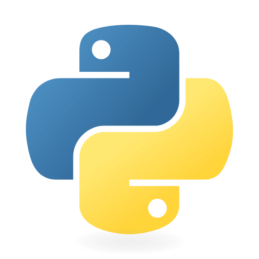
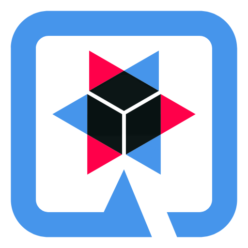
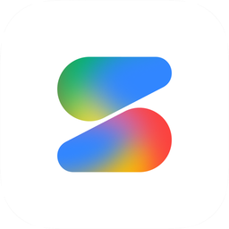
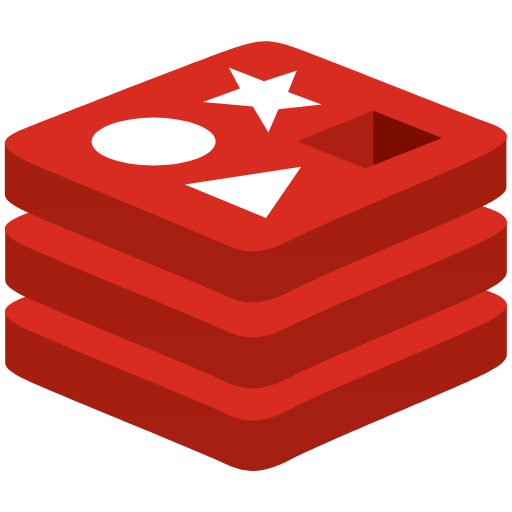
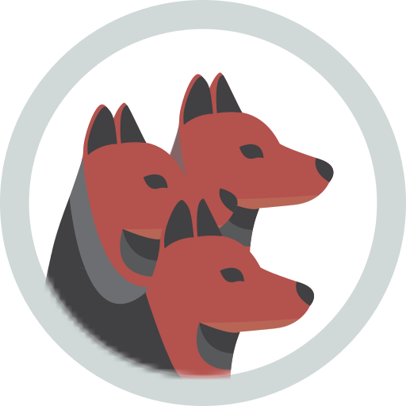
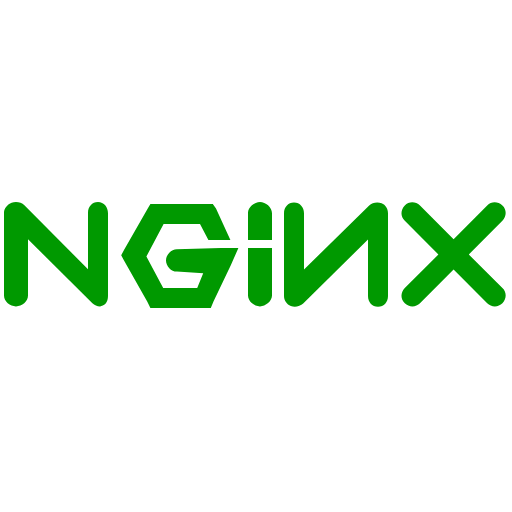
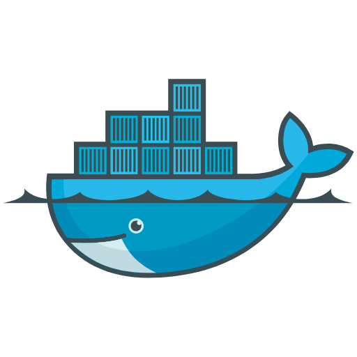
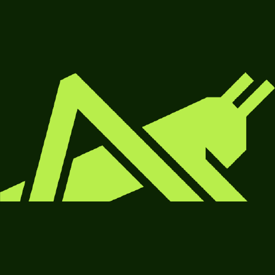

  <strong>Plataforma Distribuída de busca e indexação</strong>

  Plataforma que combina processamento distribuído, analise e mensageria assíncrona para transformar PDFs do acervo do ENADE em uma base de dados pesquisável, estruturada e segura.

 

  
  
  
  
  
  
  
  
  
  
  
  
  
  
  
  
  

  
  
  
  
  
  
  
  

> **Documentação viva:** esta documentação encontra-se em evolução contínua e pode sofrer alterações conforme novos componentes, modelos são implementados.

---