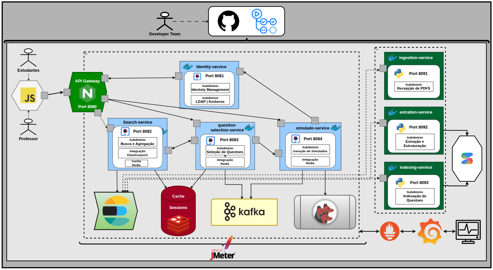

  <strong>Plataforma Distribuída de busca e indexação</strong>

  Plataforma que combina processamento distribuído, analise e mensageria assíncrona para transformar PDFs do acervo do ENADE em uma base de dados pesquisável, estruturada e segura.

 

  
  
  
  
  
  
  
  
  
  
  
  
  
  
  
  
  

  
  
  
  
  
  
  
  

> **Documentação viva:** esta documentação encontra-se em evolução contínua e pode sofrer alterações conforme novos componentes, modelos são implementados.

---

## 📖 Visão Geral

O projeto tem como objetivo principal a construção de uma plataforma distribuída de busca e indexação sobre o acervo histórico de provas do ENADE.

Os PDFs de provas, gabaritos e diretrizes são coletados e validados pelo [Python](https://www.python.org/), que atua na camada de ingestão. O `ingestion-service` armazena os arquivos brutos no [MinIO](https://min.io/), garantindo persistência durável, rastreabilidade por checksum e referência única para cada documento. Em seguida, o serviço publica um evento no [Apache Kafka](https://kafka.apache.org/), responsável por desacoplar as etapas e distribuir os dados entre os microsserviços.

No caminho de processamento, o `extraction-service`, também implementado em Python, consome os eventos de PDFs descobertos e utiliza o [PyMuPDF](https://pymupdf.readthedocs.io/) para extrair texto, páginas, blocos e elementos visuais dos documentos. Esse serviço segmenta cada questão, identifica seu tipo como objetiva, discursiva ou anulada, extrai metadados como área, curso, ano e competências, e converte fórmulas para LaTeX. Quando necessário, uma API externa de LLM multimodal auxilia no tratamento de conteúdos não textuais mais complexos.

As questões estruturadas são publicadas novamente no Kafka e consumidas pelo `indexing-service`, que realiza a indexação em lote no [Elasticsearch](https://www.elastic.co/elasticsearch/). O Elasticsearch atua como camada de busca distribuída, oferecendo análise em português, radicalização, sinônimos, relevância, filtros estruturados, agregações e destaque de trechos pesquisados.

No caminho de consulta, o `search-service`, implementado em [Java](https://www.java.com/) com [Quarkus](https://quarkus.io/), expõe uma API REST para busca full-text, filtros combináveis, paginação, highlight e agregações. O [Redis](https://redis.io/) é utilizado para armazenar resultados de buscas frequentes, sessões de autenticação e listas de questões selecionadas, reduzindo a latência das consultas e mantendo o estado do usuário durante a sessão.

A autenticação dos usuários é centralizada no `identity-service`, que integra o [OpenLDAP](https://www.openldap.org/) para validação de credenciais e gestão dos perfis STUDENT e PROFESSOR. A comunicação entre Kafka, Elasticsearch e microsserviços é protegida por [MIT Kerberos](https://web.mit.edu/kerberos/), utilizando autenticação mútua baseada em principals, keytabs e SASL/GSSAPI.

Dessa forma, a arquitetura separa claramente as responsabilidades do sistema: o Python atende à coleta e ao processamento dos PDFs, o Kafka coordena a comunicação assíncrona entre os serviços, o Elasticsearch viabiliza a busca distribuída, o Redis otimiza consultas e sessões, enquanto o Java com Quarkus concentra as APIs, a segurança e as regras de negócio.

  

---

## 🏗️ Princípios de Arquitetura

| Princípio | Descrição | Implementação na Plataforma |
|---|---|---|
| Coleta e Ingestão | Coleta, validação e disponibilização dos PDFs do acervo ENADE para processamento distribuído. | O `ingestion-service`, em Python, coleta provas, gabaritos e diretrizes, valida os arquivos, calcula checksums e publica eventos em Kafka referenciando os PDFs armazenados no MinIO. |
| Processamento de Documentos | Transformação de PDFs heterogêneos em questões estruturadas, com suporte a texto, fórmulas, diagramas e tabelas. | O `extraction-service`, em Python com PyMuPDF, segmenta questões, classifica tipos, extrai metadados e converte fórmulas para LaTeX, diagramas para Mermaid e tabelas para Markdown. |
| Mensageria | Desacoplamento entre coleta, extração, indexação e exportação por meio de eventos assíncronos. | Apache Kafka distribui eventos entre microsserviços, com tópicos por domínio, consumer groups, offsets, DLQs e suporte a reprocessamento idempotente. |
| Indexação e Busca | Indexação distribuída e consulta full-text de alta performance sobre o acervo estruturado. | O `indexing-service` consome eventos do Kafka e indexa documentos no Elasticsearch. O `search-service`, em Java/Quarkus, executa buscas full-text em PT-BR, filtros combináveis, agregações, paginação e highlight. |
| Cache e Sessão | Redução de latência em consultas frequentes e persistência temporária do estado do usuário. | O Redis armazena resultados de buscas frequentes, sessões de autenticação e listas de questões selecionadas, com TTL e política de invalidação. |
| Segurança | Autenticação de usuários, controle de perfis e proteção da comunicação entre serviços. | O `identity-service` centraliza autenticação via LDAP e emissão de sessão/token. Kerberos/SASL protege a comunicação entre Kafka, Elasticsearch e microsserviços. Perfis STUDENT e PROFESSOR controlam o acesso a gabaritos, painéis e exportações. |

### Camadas da Arquitetura

| Camada | Responsabilidade |
|---|---|
| **Ingestão** | Coleta, validação e armazenamento dos PDFs do acervo ENADE. |
| **Processamento** | Extração, segmentação e estruturação das questões e conteúdos não textuais. |
| **Mensageria** | Distribuição assíncrona de eventos entre microsserviços via Apache Kafka. |
| **Indexação** | Persistência e organização dos documentos no Elasticsearch. |
| **Busca e API** | Consulta full-text, filtros, agregações, cache e exposição REST. |
| **Seleção e Simulado** | Gestão da lista de questões selecionadas e geração/exportação de simulados. |
| **Segurança** | Autenticação LDAP, autorização por perfil e Kerberos entre serviços. |
| **Observabilidade** | Métricas, health checks, logs, dashboards e evidências experimentais. |

---

## 📦 Microsserviços

A plataforma é organizada em microsserviços independentes, cada um com responsabilidade única, porta própria, configuração isolada, health check e ciclo de build/deploy independente.

| Serviço | Responsabilidade | Stack | Porta API |
|---|---|---|---|
| [`identity-service`](./services/identity-service/README.md) | Autenticação via LDAP, sessão/token, perfis STUDENT e PROFESSOR | Java + Quarkus, LDAP, Redis | `8081` |
| [`search-service`](./services/search-service/README.md) | Busca full-text, filtros, agregações, paginação, highlight e cache | Java + Quarkus, Elasticsearch, Redis | `8082` |
| [`question-selection-service`](./services/question-selection-service/README.md) | Seleção e gestão da lista de questões do usuário | Java + Quarkus, Redis | `8083` |
| [`simulado-service`](./services/simulado-service/README.md) | Solicitação, processamento assíncrono e exportação de simulados em PDF/JSON | Java + Quarkus, Kafka, Redis, MinIO | `8084` |
| [`ingestion-service`](./services/ingestion-service/README.md) | Coleta, validação e publicação de PDFs descobertos | Python, Kafka, MinIO | `8091` |
| [`extraction-service`](./services/extraction-service/README.md) | Extração e estruturação de questões, fórmulas, diagramas e tabelas | Python, PyMuPDF, Kafka, LLM | `8092` |
| [`indexing-service`](./services/indexing-service/README.md) | Consumo de questões estruturadas e indexação no Elasticsearch | Python, Kafka, Elasticsearch | `8093` |
| [`api-gateway`](./infra/api-gateway/README.md) | Ponto único de entrada, roteamento e exposição pública das APIs | Nginx | `8080` |

## Infraestrutura e Frontend

| Componente | Endereço / Responsabilidade |
|---|---|
| Frontend | http://localhost:5173 |
| API Gateway | http://localhost:8080 |
| Kibana | http://localhost:5601 |
| Redis Insight | http://localhost:5540 |
| MinIO Console | http://localhost:9001 |
| Grafana | http://localhost:3000 |
| Prometheus | http://localhost:9090 |
| Apache Kafka | Broker interno na porta `9092` |
| Elasticsearch | Serviço interno na porta `9200` |
| OpenLDAP | Serviço interno na porta `389` |
| MIT Kerberos KDC | Serviço interno na porta `88` |

---

# 🧭 Arquitetura, Fluxos e Diagramas

Esta seção apresenta os principais fluxos, componentes, testes e decisões arquiteturais implementados no pipeline.
As imagens abaixo representam diferentes estágios de desenvolvimento e teste e destinam-se a fornecer evidência visual operando com sucesso.

Os diagramas têm como objetivo facilitar a compreensão das interações entre as funcionalidades, infraestrutura e componentes do mesmo, servindo também como referência durante o desenvolvimento e evolução da arquitetura.

> Os screenshots são intencionalmente apresentados como evidência de implementação em vez de estarem atrelados a uma categoria específica de documentação. No entanto, 
cada camada tem suas imagens e explicaçao em suas devidas configurações.

> Nota: Os padrões apresentados nesta seção representam apenas os principais conceitos arquiteturais utilizados no desenvolvimento. A documentação completa de cada domínio pode conter outros padrões e estratégias específicas. Para conhecer as demais implementações, consulte os links disponíveis nas respectivas seções e documentações das suas respectivas camadas.

---