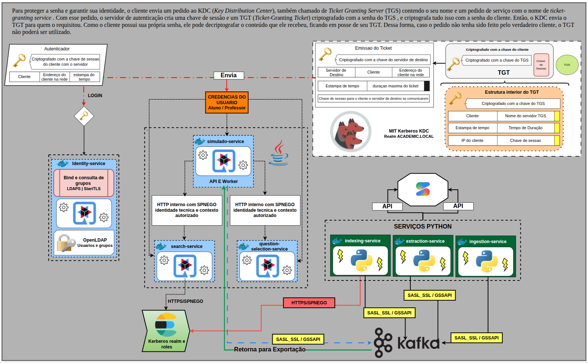
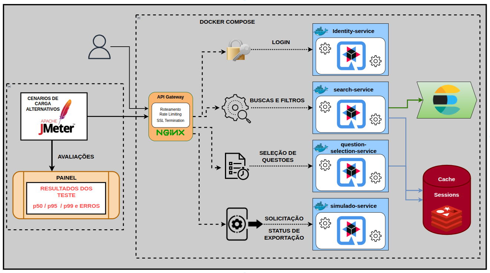

## Padrões de Arquitetura e Tratamento do Pipeline

O AcademicPass implementa uma arquitetura orientada a eventos, na qual cada etapa do ciclo de vida do documento possui um serviço especializado, um contrato de entrada e saída e uma responsabilidade técnica bem delimitada.

A plataforma não trata o PDF apenas como um arquivo a ser armazenado. Cada documento é conduzido por um pipeline de transformação progressiva: ele é descoberto, validado, persistido, processado, estruturado, indexado e disponibilizado para consulta. Essa separação permite que cada camada evolua de forma independente, seja reprocessada sem impactar as demais e seja observada de maneira isolada.

O fluxo central do pipeline é composto pelas seguintes etapas:

```text
Acervo ENADE
      ↓
ingestion-service
      ↓
MinIO + Kafka
      ↓
extraction-service
      ↓
Kafka
      ↓
indexing-service
      ↓
Elasticsearch
      ↓
search-service
      ↓
Frontend / Usuário
```

Cada etapa é desacoplada por meio do Apache Kafka, que atua como backbone de mensageria da plataforma. Dessa forma, a indisponibilidade temporária de um consumidor não interrompe a produção de eventos, permitindo que o pipeline continue operando e que os dados sejam processados posteriormente.

---

## 📥 Ingestão e Persistência de Documentos

### Coleta e validação no `ingestion-service`

O `ingestion-service` é responsável pela primeira etapa do ciclo de vida do dado: a descoberta, validação e disponibilização dos PDFs do acervo ENADE.

Esse serviço recebe documentos como provas, gabaritos e diretrizes, aplica validações iniciais e garante que apenas arquivos íntegros avancem para as etapas posteriores do pipeline. A validação considera aspectos como existência do arquivo, integridade do PDF, metadados obrigatórios e consistência das informações de origem.

Durante a ingestão, o serviço calcula o checksum do documento. Esse valor é utilizado como referência de integridade e como mecanismo auxiliar para identificar arquivos duplicados. O checksum também permite rastrear o documento original ao longo de todo o pipeline, desde o armazenamento bruto até a questão estruturada e o documento indexado.

### Persistência no MinIO

Após a validação, o PDF original é persistido no MinIO, que atua como camada de object storage da plataforma.

O MinIO é utilizado como fonte de verdade dos artefatos brutos. Isso significa que o arquivo original permanece disponível mesmo após o processamento, permitindo reprocessamento, auditoria, recuperação e evolução das estratégias de extração sem depender exclusivamente do conteúdo estruturado gerado anteriormente.

Cada objeto armazenado é referenciado por metadados que incluem:

- Identificador único do documento;
- Nome e caminho do objeto;
- Checksum de integridade;
- Origem do arquivo;
- Tipo de documento;
- Timestamp de ingestão;
- Metadados de contexto, quando disponíveis.

Essa abordagem garante que a plataforma preserve a proveniência dos dados: é possível identificar qual PDF originou determinada questão, qual versão do processador foi utilizada e quando o documento foi processado.

### Publicação do evento de descoberta

Após a persistência no MinIO, o `ingestion-service` publica um evento no Apache Kafka indicando que um novo documento está disponível para processamento.

O evento não transporta o conteúdo binário do PDF. Em vez disso, ele carrega a referência ao objeto armazenado no MinIO, os metadados de ingestão e o identificador de correlação utilizado para rastrear a execução ponta a ponta.

Essa decisão reduz o volume trafegado no Kafka, evita duplicação do arquivo em diferentes componentes e mantém o MinIO como fonte autoritativa do documento original.

<p align="center">
  
</p>

> **Documento relacionado:** [Ingestão e MinIO](./services/ingestion-service/README.md)

---

## 🧵 Mensageria Distribuída com Apache Kafka

O Apache Kafka é o componente responsável por desacoplar as etapas do pipeline e coordenar a comunicação assíncrona entre os microsserviços.

Em vez de o `ingestion-service` chamar diretamente o `extraction-service`, e este chamar diretamente o `indexing-service`, cada serviço publica eventos em tópicos específicos. Os consumidores leem esses tópicos conforme sua responsabilidade e avançam o processamento de forma independente.

Essa estratégia oferece três benefícios principais:

- **Desacoplamento temporal:** o produtor não precisa esperar a conclusão do consumidor.
- **Tolerância a falhas:** se um consumidor estiver indisponível, os eventos permanecem no tópico.
- **Escalabilidade:** consumidores podem ser replicados para aumentar a capacidade de processamento.

### Organização dos tópicos

Os tópicos são organizados por domínio e finalidade, permitindo separar eventos de descoberta, processamento, indexação e geração de simulados.

| Tópico | Produtor | Consumidor | Finalidade |
|---|---|---|---|
| `documents.discovered` | `ingestion-service` | `extraction-service` | Notifica a existência de um PDF validado e persistido. |
| `questions.structured` | `extraction-service` | `indexing-service` | Transporta questões estruturadas para indexação. |
| `questions.indexed` | `indexing-service` | Monitoramento | Confirma a indexação no Elasticsearch. |
| `simulados.requested` | `simulado-service` | Serviço de processamento | Solicita a geração assíncrona de um simulado. |
| `simulados.completed` | Serviço de processamento | `simulado-service` | Informa a conclusão e a localização do artefato. |
| `processing.failed` | Consumidores do pipeline | DLQ / monitoramento | Registra falhas não recuperáveis ou esgotadas após retries. |

### Semântica de entrega e idempotência

O pipeline adota entrega **at-least-once**, garantindo que um evento publicado no Kafka seja processado pelo consumidor. Como consequência, o mesmo evento pode ser entregue mais de uma vez em cenários de reinício, falha de rede ou reprocessamento.

Por esse motivo, todos os consumidores devem implementar idempotência.

No `indexing-service`, por exemplo, o processamento repetido de um mesmo evento não deve gerar múltiplas entradas no Elasticsearch. A idempotência é garantida por meio de identificadores determinísticos, como `document_id` e `question_id`, que permitem atualizar ou substituir o documento indexado em vez de criar duplicidades.

### Reprocessamento e DLQ

Eventos que falham temporariamente podem ser reprocessados por meio de retries controlados. Já eventos que apresentam falha definitiva — como PDF corrompido, formato inválido ou inconsistência estrutural — são encaminhados para uma Dead Letter Queue (DLQ).

A DLQ permite que a equipe analise a causa da falha sem comprometer o avanço do pipeline. Dessa forma, mensagens problemáticas não bloqueiam o consumo das demais mensagens válidas.

<p align="center">
  
</p>

> **Documento relacionado:** [Mensageria e Kafka](./docs/messaging/overview.md)

---

## 🧠 Processamento e Estruturação de Documentos

### Extração com PyMuPDF

O `extraction-service` consome os eventos de PDFs descobertos e utiliza o PyMuPDF para realizar a leitura estrutural dos documentos.

O processamento não se limita à extração simples de texto. O serviço percorre páginas, blocos, linhas, elementos visuais e metadados do PDF para reconstruir a organização lógica do documento.

Durante essa etapa, o serviço identifica:

- Páginas e limites de questões;
- Enunciados;
- Alternativas;
- Blocos de texto;
- Fórmulas;
- Tabelas;
- Diagramas e elementos visuais;
- Metadados contextuais, como área, curso, ano e competências.

### Segmentação de questões

A segmentação é uma das etapas mais críticas do pipeline, pois os PDFs do ENADE possuem layouts heterogêneos, diferentes formas de diagramação e conteúdos distribuídos de maneiras variadas.

O `extraction-service` aplica heurísticas estruturais para identificar o início e o fim de cada questão, associando enunciado, alternativas, elementos visuais e metadados ao mesmo registro lógico.

Cada questão é classificada conforme seu tipo:

| Tipo | Descrição |
|---|---|
| `OBJETIVA` | Questão com alternativas e resposta única esperada. |
| `DISCURSIVA` | Questão que exige resposta dissertativa ou análise textual. |
| `ANULADA` | Questão invalidada ou sem aproveitamento no contexto da prova. |

### Conversão de conteúdos complexos

Conteúdos que não podem ser representados adequadamente como texto simples passam por transformações específicas.

| Conteúdo original | Representação estruturada |
|---|---|
| Fórmulas matemáticas | LaTeX |
| Tabelas | Markdown |
| Diagramas e fluxogramas | Mermaid |
| Imagens e elementos visuais | Referência, descrição e metadados |
| Texto fragmentado | Blocos normalizados e ordenados |

Quando o conteúdo apresenta alta complexidade — como diagramas pouco legíveis, fórmulas compostas ou elementos visuais ambíguos — o serviço pode utilizar uma API externa de LLM multimodal de forma assistiva.

O uso do LLM não substitui o processamento determinístico do pipeline. Ele atua como apoio para interpretação de conteúdos complexos, sempre preservando rastreabilidade, validação e possibilidade de revisão humana.

<p align="center">
  
</p>

> **Documento relacionado:** [Extração e estruturação](./services/extraction-service/README.md)

---

## 🔎 Indexação Distribuída no Elasticsearch

### Papel do `indexing-service`

O `indexing-service` consome os eventos de questões estruturadas publicados no Kafka e realiza a indexação no Elasticsearch.

Esse serviço é responsável por transformar as questões estruturadas em documentos pesquisáveis, aplicando o mapping adequado, normalizando campos e garantindo que as informações estejam disponíveis para busca, filtros, agregações e destaque de resultados.

### Organização dos índices

O Elasticsearch organiza o acervo em índices por domínio e versão de estrutura. Essa separação permite evoluir o modelo de dados sem comprometer consultas existentes.

Cada documento indexado pode conter informações como:

- `question_id`;
- `document_id`;
- Enunciado;
- Alternativas;
- Tipo de questão;
- Área;
- Curso;
- Ano;
- Competências;
- Fórmulas em LaTeX;
- Tabelas em Markdown;
- Diagramas em Mermaid;
- Referência ao PDF original no MinIO;
- Metadados de processamento.

### Busca full-text em português

O Elasticsearch atua como camada de busca distribuída da plataforma. Ele permite consultas full-text sobre enunciados, alternativas e conteúdos relacionados, com suporte a análise em português.

As capacidades de busca incluem:

- Tokenização e normalização textual;
- Radicalização de termos;
- Suporte a sinônimos;
- Cálculo de relevância;
- Filtros estruturados;
- Agregações;
- Paginação;
- Highlight de trechos encontrados.

Dessa forma, uma busca por um conceito, tema, disciplina ou palavra-chave consegue retornar questões relevantes mesmo quando o termo pesquisado não aparece exatamente igual ao texto original.

### Atualização e reindexação

A indexação é tratada como um processo evolutivo. Quando o modelo de dados, o analisador ou a estratégia de extração é alterado, novos índices podem ser criados e validados antes de substituírem os índices anteriores.

O uso de aliases permite trocar a versão ativa do índice sem interromper o `search-service`, reduzindo o impacto de reindexações e facilitando rollback em caso de inconsistências.

<p align="center">
  
</p>

> **Documento relacionado:** [Indexação e Elasticsearch](./services/indexing-service/README.md)

---

## ⚡ Consulta, Cache e Sessão

### API de busca com Java e Quarkus

O `search-service` é implementado em Java com Quarkus e expõe a API REST responsável pelas consultas ao acervo estruturado.

Esse serviço recebe requisições do frontend por meio do `api-gateway`, valida o contexto de autenticação, interpreta os filtros recebidos e executa as consultas no Elasticsearch.

As consultas suportam:

- Busca full-text;
- Filtros combináveis;
- Paginação;
- Ordenação por relevância;
- Agregações;
- Highlight;
- Restrições por perfil de usuário.

### Redis como camada de baixa latência

O Redis é utilizado para reduzir a latência de operações frequentes e manter informações temporárias associadas à sessão do usuário.

Ele não substitui o Elasticsearch como fonte de busca nem o MinIO como fonte dos documentos originais. Sua função é otimizar acessos recorrentes e preservar estado de curta duração.

| Uso do Redis | Finalidade |
|---|---|
| Cache de buscas frequentes | Reduz consultas repetidas ao Elasticsearch. |
| Sessões de autenticação | Mantém o contexto autenticado do usuário. |
| Lista de questões selecionadas | Preserva o estado de seleção durante a navegação. |
| Controle de operações temporárias | Suporta fluxos como geração e acompanhamento de simulados. |

### Política de expiração e invalidação

Os dados armazenados no Redis possuem TTL, garantindo que informações temporárias não permaneçam indefinidamente em memória.

A invalidação é aplicada quando:

- A sessão do usuário é encerrada;
- O usuário altera sua seleção de questões;
- O resultado de uma busca deixa de ser válido;
- O contexto de autenticação é renovado;
- Uma operação assíncrona é concluída.

Essa estratégia equilibra performance, consumo de memória e consistência do estado apresentado ao usuário.

> **Documento relacionado:** [Busca, cache e sessão](./services/search-service/README.md)

---

## 🔐 Segurança, Identidade e Comunicação Protegida

### Autenticação centralizada

A autenticação dos usuários é centralizada no `identity-service`, que valida credenciais por meio do OpenLDAP e emite o contexto de sessão utilizado pelos demais serviços.

O OpenLDAP atua como fonte autoritativa de identidade, enquanto o Redis armazena informações temporárias de sessão. Essa separação permite validar credenciais de forma centralizada e manter o estado autenticado com baixa latência.

### Perfis de acesso

A plataforma utiliza perfis funcionais para controlar o acesso às funcionalidades.

| Perfil | Capacidades principais |
|---|---|
| `STUDENT` | Busca de questões, aplicação de filtros, seleção de questões e geração de simulados. |
| `PROFESSOR` | Acesso ampliado a gabaritos, metadados, painéis e exportações autorizadas. |

A autorização é aplicada tanto na camada de API quanto na lógica de negócio, impedindo que um usuário acesse recursos fora do escopo do seu perfil.

### Kerberos, SASL e GSSAPI

A comunicação entre Kafka, Elasticsearch e microsserviços é protegida por MIT Kerberos.

O Kerberos utiliza principals, keytabs e autenticação mútua para garantir que apenas componentes autorizados consigam interagir com os serviços protegidos. A integração é realizada por meio de SASL/GSSAPI, que estabelece o contexto de segurança durante a comunicação.

Essa abordagem evita que serviços internos dependam apenas de credenciais simples ou conexões não autenticadas, reduzindo a superfície de ataque da plataforma.

### Princípios de segurança

- Nenhum segredo deve ser versionado no repositório.
- Keytabs, senhas, tokens e credenciais devem ser fornecidos por mecanismos seguros.
- Logs não devem conter informações sensíveis.
- Cada serviço deve utilizar o princípio do menor privilégio.
- Alterações em autenticação, autorização ou criptografia exigem revisão técnica adicional.

<p align="center">
  
</p>

> **Documento relacionado:** [Segurança e Kerberos](./docs/security/overview.md)

---

## 📈 Observabilidade e Validação Operacional

A observabilidade da plataforma é construída para permitir acompanhar não apenas se os serviços estão disponíveis, mas também como o pipeline está se comportando em cada etapa.

### Prometheus e Grafana

O Prometheus coleta métricas dos microsserviços e componentes de infraestrutura, enquanto o Grafana concentra os dashboards utilizados para análise operacional.

Os principais indicadores acompanhados incluem:

| Indicador | Finalidade |
|---|---|
| Latência das APIs | Avaliar o tempo de resposta do `search-service` e demais endpoints. |
| Taxa de erros HTTP | Identificar falhas e instabilidade nas APIs. |
| Consumer lag do Kafka | Detectar atraso no processamento assíncrono. |
| Eventos processados | Acompanhar o volume tratado por cada serviço. |
| Documentos indexados | Medir o progresso da indexação no Elasticsearch. |
| Falhas de extração | Monitorar a qualidade do processamento dos PDFs. |
| Uso de cache | Avaliar a efetividade do Redis. |
| Disponibilidade dos serviços | Verificar a saúde geral da plataforma. |

### Health checks

Cada microsserviço expõe health checks que permitem verificar sua disponibilidade e o estado das dependências críticas.

Um health check deve refletir não apenas se o processo está em execução, mas também se o serviço consegue acessar seus componentes essenciais, como Kafka, Elasticsearch, Redis, MinIO ou LDAP.

### Logs estruturados

Os logs são estruturados para permitir busca, filtragem e correlação entre serviços.

Cada registro operacional deve incluir, quando aplicável:

- Serviço responsável;
- Nível de log;
- Timestamp;
- `correlation_id`;
- Identificador do documento ou questão;
- Etapa do pipeline;
- Mensagem técnica;
- Contexto de erro, quando aplicável.

Dessa forma, é possível acompanhar a jornada de um documento desde a ingestão até a indexação, identificando onde ocorreram falhas ou gargalos.

<p align="center">
  
</p>

> **Documento relacionado:** [Observabilidade e monitoramento](./docs/observability/overview.md)

---

## Pipeline e verificações


> **Documento relacionado:** [Esteira e Motores](./docs/observability/overview.md)

---

## 🧪 Testes, Qualidade e Validação

A validação do AcademicPass não se limita ao teste unitário de funções isoladas. Como o sistema é distribuído e orientado a eventos, a estratégia de testes precisa cobrir integração entre serviços, persistência, mensageria, busca e comportamento sob carga.

### Níveis de validação

| Nível | Objetivo |
|---|---|
| Testes unitários | Validar regras internas, parsers, transformações e funções isoladas. |
| Testes de integração | Validar a comunicação com Kafka, Elasticsearch, Redis, MinIO e LDAP. |
| Testes de contrato | Garantir compatibilidade entre APIs REST e eventos Kafka. |
| Testes end-to-end | Validar o fluxo completo, da ingestão até a busca ou geração de simulado. |
| Testes de carga | Avaliar latência, throughput e comportamento sob concorrência. |

### Ferramentas de validação

- **Pytest** para validação dos serviços Python.
- **Testes do Quarkus** para validação dos serviços Java.
- **Testcontainers** ou ambientes efêmeros para testes de integração.
- **Locust** para simulação de carga e concorrência.
- **JMeter** para testes de performance e validação de cenários de acesso.
- **GitHub Actions** para automação da esteira de validação.

### Critérios de qualidade

Uma alteração somente deve ser considerada apta para integração quando:

- Os testes automatizados forem aprovados;
- A documentação relacionada for atualizada;
- Os contratos de API e eventos permanecerem compatíveis;
- O comportamento do pipeline for validado nos pontos afetados;
- Não houver exposição de dados sensíveis;
- As evidências de execução forem preservadas quando aplicável.


<p align="center">
  
</p>

> **Documento relacionado:** [Estratégia de testes](./docs/testing/overview.md)

---

## Conclusão Técnica

O AcademicPass implementa uma plataforma distribuída de busca e indexação que combina processamento de documentos, mensageria assíncrona, busca full-text, cache, segurança e observabilidade.

A arquitetura separa claramente as responsabilidades do sistema: o Python atua na ingestão e no processamento dos PDFs, o Kafka coordena a comunicação assíncrona entre os microsserviços, o Elasticsearch viabiliza a busca distribuída, o Redis otimiza consultas e sessões, enquanto o Java com Quarkus concentra as APIs, a segurança e as regras de negócio.

O MinIO preserva os documentos originais como fonte de verdade, o PyMuPDF viabiliza a extração estrutural dos conteúdos, e o uso assistivo de LLM multimodal complementa o tratamento de elementos complexos como fórmulas, diagramas e tabelas.

Dessa forma, a plataforma transforma um acervo heterogêneo de PDFs em uma base de dados pesquisável, estruturada, rastreável e segura, sustentando operações de busca, seleção de questões e geração de simulados.

---

Copyright © 2026 AcademicPass.